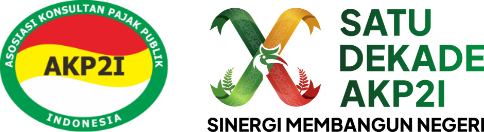

<p align="center"></p>

# Website PD AKP2I Jawa Barat

Website resmi dan sistem informasi Pengurus Daerah Asosiasi Konsultan Pajak Publik Indonesia (AKP2I) Provinsi Jawa Barat: situs publik, keanggotaan, iuran, pelatihan/event bersertifikat, serta konten organisasi, dikelola oleh PD dan Pengurus Cabang (PC).

## Fitur

- **Situs publik**: beranda (slider, berita, agenda, galeri), profil & sambutan, pengurus PD dan halaman tiap PC, berita, galeri, jurnal, forum, dokumen, cek anggota, verifikasi sertifikat, kontak.
- **Keanggotaan**: data anggota per cabang (Utama/Madya/Pratama/Kehormatan; aktif/skors/berhenti), impor Excel, iuran tahunan dengan bukti bayar, usulan skors otomatis untuk anggota menunggak.
- **Kepengurusan**: periode, bidang, jabatan, dan pengurus PD maupun PC.
- **Pelatihan & event** (PPL, Brevet, seminar, webinar): pendaftaran online, biaya anggota/umum, verifikasi bukti transfer, tiket & kehadiran, sertifikat PDF otomatis dengan jam SKP.
- **Konten**: berita (review editor sebelum tayang), forum dengan laporan, jurnal PDF, galeri, slider, halaman CMS.
- **Hak akses**: Super Admin, Admin PD, Editor, Admin PC (hanya cabangnya), Anggota, Umum; log aktivitas admin.

Kebutuhan lengkap ada di [docs/PRD.md](docs/PRD.md), progres per milestone di [docs/milestones/](docs/milestones/).

## Teknologi

Laravel 12, PHP ≥ 8.2 (ekstensi GD), MySQL 5.7+, Node.js (Vite + Tailwind), spatie/laravel-permission, yajra/laravel-datatables, barryvdh/laravel-dompdf, simplesoftwareio/simple-qrcode.

## Instalasi lokal

```bash
composer install
npm install && npm run build
cp .env.example .env && php artisan key:generate   # isi DB_* dan MAIL_*
php artisan migrate --seed       # data uji sederhana (dipakai test otomatis)
php artisan storage:link
php artisan serve
```

Untuk presentasi dengan data contoh yang realistis (gambar, 150 anggota, event, sertifikat) lihat [docs/DEMO.md](docs/DEMO.md). Semua akun seeder memakai password `password`.

Menjalankan test: `php artisan test`.

## Deploy produksi

> **Jangan** menjalankan `db:seed` tanpa `--class` atau `DemoSeeder` di produksi: keduanya membuat akun dengan password `password` dan data fiktif.

1. `.env`: `APP_ENV=production`, `APP_DEBUG=false`, `APP_URL` (https), `DB_*`, `QUEUE_CONNECTION=database`, `MAIL_MAILER=smtp` + kredensial SMTP. File `.env` tidak pernah di-commit.
2. Pasang aplikasi:
   ```bash
   composer install --no-dev --optimize-autoloader
   npm ci && npm run build
   php artisan key:generate          # hanya pada instalasi pertama
   php artisan migrate --force
   php artisan db:seed --class=RolePermissionSeeder --force
   php artisan db:seed --class=ContentTaxonomySeeder --force
   php artisan storage:link
   php artisan config:cache && php artisan route:cache && php artisan view:cache
   ```
3. Buat akun super admin (ganti nama, email, password):
   ```bash
   php artisan tinker --execute='$u = App\Models\User::create(["name" => "Nama Admin", "email" => "admin@domain.id", "password" => Hash::make("password-kuat")]); $u->markEmailAsVerified(); $u->assignRole("super_administrator");'
   ```
4. Jalankan antrean (email, sertifikat PDF) dengan Supervisor/systemd: `php artisan queue:work --tries=3`.
5. Cron untuk scheduler (usulan skors harian 07.00):
   `* * * * * cd /path/ke/aplikasi && php artisan schedule:run >> /dev/null 2>&1`
6. Login sebagai super admin, lalu isi **Pengaturan** (kontak, rekening, iuran), **Organisasi** (PC), kepengurusan, dan halaman profil/sambutan dengan konten resmi.

## Lisensi

Dikembangkan dari [Bara Asa Project](https://github.com/ahdiatahsan/baraasaproject) (MIT). Font poster demo: Plus Jakarta Sans (SIL OFL); foto demo: Wikimedia Commons, lihat `database/seeders/demo-assets/photos/CREDITS.md`.
